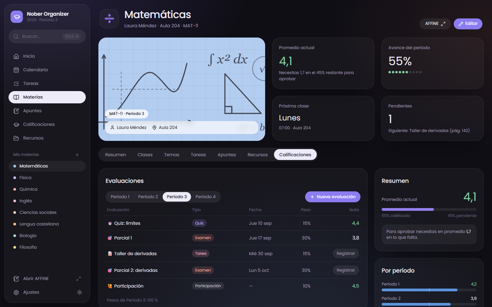

<a href="https://www.buymeacoffee.com/samons" target="_blank">
  
</a>

# Nober Organizer

**English** · [Español](README.es.md)

**An open-source, self-hosted school planner** for students: courses with a weekly timetable, tasks, calendar,
grades by term, topics, resources, projects, online courses and class notes in [Obsidian](https://obsidian.md),
all in one place. Dark and light themes, built for desktop and mobile.

> The interface is in Spanish (Colombian format: 24 h, weeks start on Monday). Help translating it is welcome.


| Tasks (board) | Calendar (week) |
| --- | --- |
|  |  |
| **Grades** | **Course** |
|  |  |

## Features

- **Home**: what's most urgent, today's classes, this week's tasks, upcoming assignments and exams, term average,
  focus timer, goals and a monthly calendar. New accounts get a getting-started guide.
- **Courses**: color, cover, teacher, room and a **weekly timetable** (the calendar generates classes from it).
  Each course has an overview, classes, topics (board by preparation level), tasks, notes, resources and grades.
- **Tasks**: list, board (drag and drop) and by-date views; steps, links, tags, priority, notes and file attachments.
- **Calendar**: month, week and agenda views with classes, deadlines, exams, events and **holidays** (they remove
  that day's classes).
- **Projects**: personal or work projects (status, target date, progress) with their tasks, files and a folder of
  notes in Obsidian; the `- [ ]` checkboxes in those notes (Tasks plugin format) show up and can be ticked in the app.
- **Online courses (Coursera)**: import a course by its link (or a whole program, e.g. a 6-course certificate) and
  choose how long you study each day. Nober builds study sessions **lesson by lesson** using Coursera's time estimates
  (each session's steps are its videos and readings), creates one note per module in Obsidian and, with a browser
  bookmarklet, detects the courses you start and marks what you've completed.
- **Review**: spaced-repetition flashcards (Again / Hard / Good / Easy) and multiple-choice practice quizzes, generated
  with AI from your notes or from a module's syllabus; what you miss in a quiz becomes flashcards.
- **Grades**: configurable scale (1.0–5.0 by default, passing at 3.0), weighted terms, scores on a different scale
  (85/100 → 4.3), the grade you still need to pass, and a simulator.
- **Notes in Obsidian**: every class has its own `.md` note in your vault (with a template and properties). Read and
  edit it in a panel inside the app (math, clickable task checkboxes, `[[links]]`, images and PDF attachments) or open
  it in the Obsidian app with one click. Content lives in your vault; your Obsidian sync takes it to your devices.
- **Accounts**: email and password (Google optional) with [Better Auth](https://better-auth.com). Each user only
  sees their own data, and sign-ups can be closed once your account exists.

## Integrations

- **Obsidian**: "Crear apunte" creates the class note from a template; if you move or rename it in Obsidian, the app
  finds it again. Autosave never overwrites a change made in Obsidian meanwhile: it asks which version to keep.
- **AI (optional)**: summaries, review questions, note → tasks, flashcards, quizzes, a weekly study plan, "project
  with AI" (an idea → a project with its task plan) and task breakdown. Works with any OpenAI-compatible API that
  supports JSON-schema responses; [Groq](https://console.groq.com) has a free tier. The AI only proposes: nothing is
  written or created without your confirmation.
- **Coursera**: a bookmarklet created in Settings reads your courses and progress **in your browser** (your Coursera
  session never reaches the server) and sends them with a personal key (only its hash is stored). It relies on
  undocumented Coursera endpoints, which may change.
- **Google Calendar**: a dedicated calendar with recurring classes (skipping holidays), tasks, assessments and
  events, without duplicates; other calendars can be shown read-only.
- **Push reminders**: deadlines, exams and flashcards due today, on every device you enable (PWA on iOS 16.4+).
- **Files**: upload PDFs, documents, images, audio or video to tasks, resources and projects (only the owner can
  open them).
- **PWA**: install it on your phone from the browser ("Add to Home Screen").

Setup instructions are in the deployment guide ([`deploy/README.md`](deploy/README.md), in Spanish).

## Self-hosting (Docker)

Requirements: a server with Docker and Docker Compose, and a domain with HTTPS (nginx, Caddy, Cloudflare…).

```bash
git clone https://github.com/SamonsLol/nober-organizer.git
cd nober-organizer
cp .env.production.example .env.production   # fill in: passwords, domain, Obsidian, AI, push keys
docker compose --env-file .env.production up -d --build
curl -s http://127.0.0.1:3100/api/health     # {"ok":true,"db":true}
```

Then expose `127.0.0.1:3100` through your reverse proxy (nginx template in
[`deploy/nginx/nober.conf`](deploy/nginx/nober.conf)). The full guide (DNS, nginx, first run, updates and backups)
is in [`deploy/README.md`](deploy/README.md).

### Obsidian

The app works on **a copy of your vault on the server** (a folder with `.obsidian/`) kept up to date by whatever sync
you already use: [Self-hosted LiveSync](https://github.com/vrtmrz/obsidian-livesync) (with an always-on Obsidian on
the server, e.g. the `linuxserver/obsidian` image), Obsidian Sync with the desktop client, Syncthing, git…

| Variable | Meaning |
| --- | --- |
| `OBSIDIAN_VAULT_DIR` | Vault path on the server (mounted into the container; uid 1000 must be able to write) |
| `OBSIDIAN_VAULT_NAME` | Vault name in Obsidian, for `obsidian://` links (defaults to the folder name) |
| `OBSIDIAN_NOTES_ROOT` | Class notes folder: `<root>/<course>/<date> <class>.md` (default `Apuntes`) |
| `OBSIDIAN_PROJECTS_ROOT` | Projects folder: `<root>/<project>/` (default `Proyectos`) |
| `OBSIDIAN_ALLOWED_EMAILS` | Accounts allowed to use the vault (empty = every account on the instance) |
| `OBSIDIAN_WEB_URL` | Optional: Obsidian in the browser, for the "Abrir Obsidian" button |

Without a vault the app works the same, just without creating or opening notes.

### AI

| Variable | Meaning |
| --- | --- |
| `AI_API_KEY` | Provider key (empty = no AI) |
| `AI_BASE_URL` | OpenAI-compatible base URL (default `https://api.groq.com/openai/v1`) |
| `AI_MODEL` | Model (default `openai/gpt-oss-120b`) |

Note content is sent to the provider you configure.

## Development

Requirements: Node 22 or newer and Docker (for PostgreSQL).

```bash
npm install
cp .env.example .env        # generate BETTER_AUTH_SECRET (the command is in the file)
npm run db:up               # PostgreSQL 17 on localhost:5433
npm run db:migrate
npm run db:seed             # demo user demo@example.com / nober-demo-2026 with sample data
npm run dev                 # http://localhost:3000
```

Without `DATABASE_URL` the app starts in **demo mode** (sample data in memory, no sign-in), handy for UI work.

Other commands: `npm run lint` (TypeScript), `npm run build`, `npm run db:studio` (Prisma Studio).

### Stack

Next.js 16 (App Router, Server Actions) · React 19 · TypeScript · Tailwind CSS v4 · Prisma 7 + PostgreSQL ·
Better Auth · date-fns · lucide-react. No component library: the design system is custom
(`src/app/globals.css` and `src/components/blocks`).

```
src/
  app/(app)/          screens (home, calendar, tasks, courses, projects, notes, grades, resources, settings)
  app/api/            auth, files, vault, Coursera, reminders and health
  components/         one view per screen, editors (dialogs) and design blocks
  lib/actions/        Server Actions (validated with zod, always scoped to the user)
  lib/data/           data layer: loads the user's data and derives what each screen needs
  lib/vault.ts        Obsidian vault access (never outside the vault)
  lib/coursera*.ts    Coursera public API and bookmarklet sync
prisma/               schema, migrations and seed
deploy/               nginx template, backup script and deployment guide
```

## Roadmap

- Data export and import.
- More online-course platforms besides Coursera.
- Interface translations.

## Contributing

Contributions are welcome! See [`CONTRIBUTING.md`](CONTRIBUTING.md) (in Spanish). Please don't open public issues
for security problems; contact the maintainer instead.

## License

Copyright (C) 2026 Samuel and Nober Organizer contributors.

Licensed under the [GNU Affero General Public License](LICENSE), version 3 or (at your option) any later version (AGPL-3.0-or-later). You can use, study, modify and
share it; if you run a modified version as a web service, you must offer its source code to its users. The app
links to its source in the sign-in page and in Settings; set `NEXT_PUBLIC_SOURCE_URL` to your fork if you change it.

Original design and code; the content structure is inspired by academic Notion templates, with no affiliation to
their authors.
